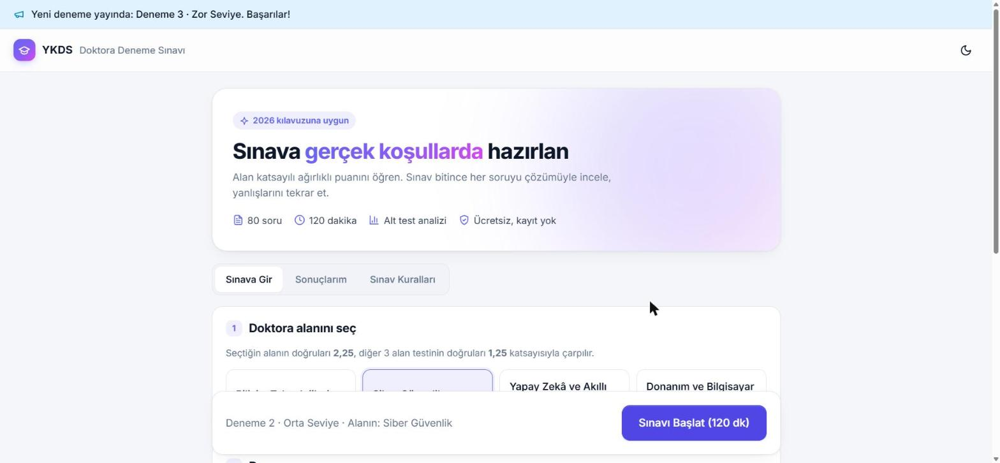
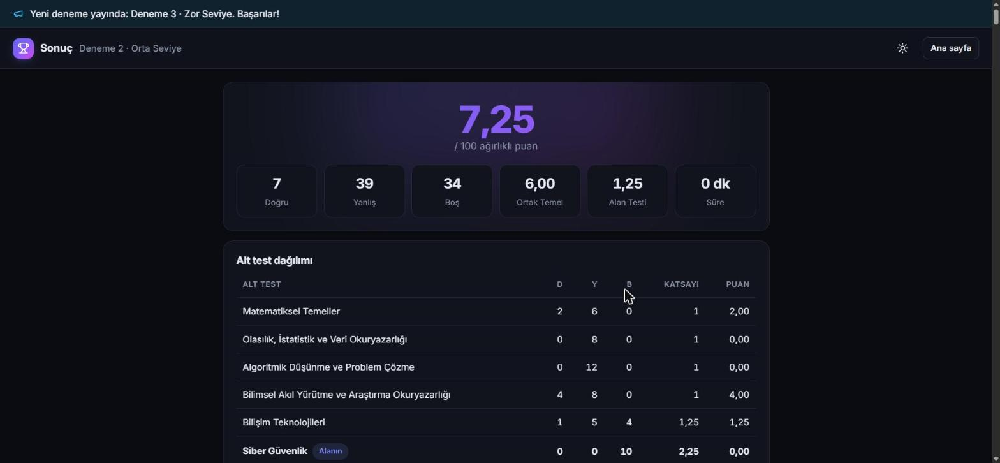
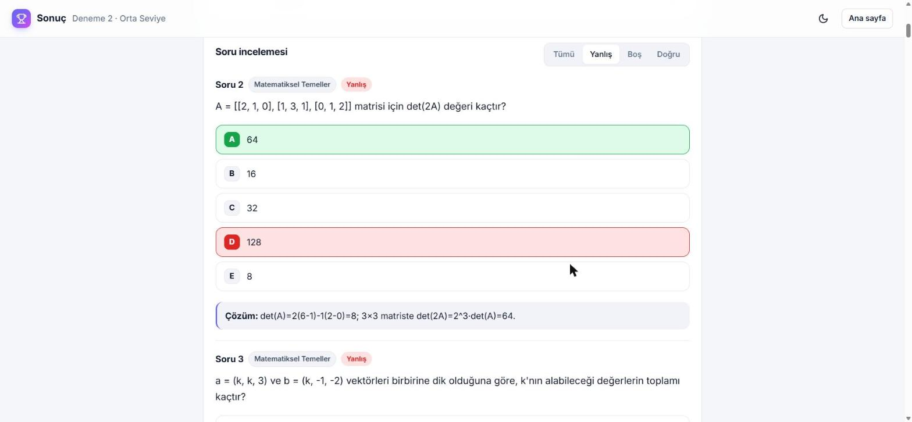

# YKDS Deneme Sınavı

### Doktora öncelikli alanlar sınavına gerçek koşullarda hazırlan

80 soru · 120 dakika · alan katsayılı puan · çözümlü inceleme · **ücretsiz, kayıt yok**

  

---

## Bu site ne işe yarar?

**YKDS Deneme**, YÖK-YKDS doktora öncelikli alanlar sınavına hazırlanan adaylar için hazırlanmış bir **online deneme sınavı** platformudur. 2026 başvuru kılavuzundaki sınav yapısını birebir uygular: aynı soru sayısı, aynı süre, aynı alt testler ve aynı puan hesabı.

Denemeyi bitirdiğinde sadece puanını değil, **hangi alt testte ne kadar iyi olduğunu** ve **her sorunun doğru cevabını çözümüyle** görürsün. Yanlış yaptığın sorular tekrar çalışabilmen için bir listede toplanır.

## Nasıl kullanılır?

| | |
|---|---|
| **1. Alanını seç** | Bilişim Teknolojileri, Siber Güvenlik, Yapay Zekâ veya Donanım. Kendi alanının soruları daha yüksek katsayıyla sayılır. |
| **2. Bir deneme seç** | Listeden çözmek istediğin denemeyi seç. |
| **3. Sınavı başlat** | 120 dakikalık süre başlar. Soruları istediğin sırayla çöz, emin olmadıklarını işaretle, sonra geri dön. |
| **4. Sonucunu incele** | Ağırlıklı puanını, alt test tablonu ve her sorunun çözümünü gör. |

<table>
  <tr>
    <td width="50%">
<b>Sınav ekranı</b> · soru paleti, işaretleme, geri sayım
</td>
    <td width="50%">
<b>Sonuç</b> · ağırlıklı puan ve alt test dağılımı
</td>
  </tr>
  <tr>
    <td>
<b>Çözümlü inceleme</b> · doğru cevap ve açıklama
</td>
    <td>
<b>Koyu tema</b> · gözü yormayan çalışma
</td>
  </tr>
</table>

## Öne çıkanlar

- 🎯 **Gerçek sınav yapısı:** 80 soru, 120 dakika, 5 şıklı sorular; yanlışlar doğruyu götürmez
- 🧮 **Resmî puan hesabı:** Ortak Temel + kendi alanın × 2,25 + diğer alanlar × 1,25 (en fazla 100)
- 📊 **Alt test analizi:** 8 alt testte doğru, yanlış ve boş sayıların ve puanın
- 💡 **Çözümlü inceleme:** her sorunun doğru cevabı ve açıklaması
- 🔁 **Tekrar listesi:** en son yanlış yaptığın ve boş bıraktığın sorular tek yerde
- 📈 **Gelişim takibi:** çözdüğün tüm denemelerin puan geçmişi
- ⌨️ **Klavye kısayolları:** <kbd>A</kbd>–<kbd>E</kbd> şık seç · <kbd>←</kbd> <kbd>→</kbd> soru değiştir · <kbd>F</kbd> işaretle
- 💾 **Kaldığın yerden devam:** sayfa kapansa ya da internet gitse bile süre ve cevapların korunur
- 🌗 **Açık ve koyu tema**, telefon ve tablet uyumlu
- 🔒 **Adil sınav:** cevap anahtarı sınavı bitirene kadar sunucuda kalır, tarayıcıdan görülemez

## Sınav yapısı

| Bölüm | Alt test | Soru |
|---|---|:---:|
| **Ortak Temel Test** | Matematiksel Temeller | 8 |
| | Olasılık, İstatistik ve Veri Okuryazarlığı | 8 |
| | Algoritmik Düşünme ve Problem Çözme | 12 |
| | Bilimsel Akıl Yürütme ve Araştırma Okuryazarlığı | 12 |
| **Alan Testi** | Bilişim Teknolojileri | 10 |
| | Siber Güvenlik | 10 |
| | Yapay Zekâ ve Akıllı Sistemler | 10 |
| | Donanım ve Bilgisayar Sistemleri | 10 |
| | **Toplam** | **80** |

> **Ağırlıklı puan** = Ortak Temel doğruları + (kendi alanının doğruları × 2,25) + (diğer 3 alanın doğruları × 1,25)
>
> Resmî sınav puanı, ağırlıklı puanın diğer adaylara göre dönüştürülmesiyle bulunur. Bu sitede ağırlıklı puanını görürsün.

## Sık sorulan sorular

<b>Üye olmam gerekiyor mu?</b>

 Hayır. Siteyi açıp hemen sınava başlayabilirsin. Hiçbir kişisel bilgi istenmez.

<b>Ücretli mi?</b>

 Hayır, tamamen ücretsiz.

<b>Sonuçlarım nerede saklanıyor?</b>

 Sadece kendi tarayıcında. Bu yüzden başka bir cihazda görünmez. Tarayıcı verilerini silersen geçmişin de silinir.

<b>Sınavın ortasında sayfa kapanırsa ne olur?</b>

 Siteyi tekrar açtığında ana sayfada "Devam eden sınavın var" kutusu çıkar. Süre ve cevapların olduğu gibi korunur.

<b>Süre bitince ne oluyor?</b>

 Sınav otomatik olarak teslim edilir ve sonucun gösterilir. Boş bıraktığın sorular boş sayılır.

<b>Sorular gerçek ÖSYM soruları mı?</b>

 Hayır. Tüm sorular bu platform için özgün olarak hazırlanmıştır ve sınav kılavuzundaki konu başlıklarını kapsar.

<b>Telefondan çözebilir miyim?</b>

 Evet. Site telefon ve tablette de çalışır. Yine de gerçek sınava en yakın deneyim için bilgisayar önerilir.

## Deneme hazırlayanlar için

Denemeler, yöneticilerin kullandığı ayrı bir **yönetim panelinden** yüklenir ve yayınlanır. Panelde her denemenin kaç kez çözüldüğü, ortalama puanı ve öğrencilerin en çok zorlandığı sorular görülebilir.

<table>
  <tr>
    <td width="50%">
Genel bakış
</td>
    <td width="50%">
En zor sorular ve alan dağılımı
</td>
  </tr>
</table>

## Gizlilik

- Üyelik yoktur. Ad, e-posta ya da başka bir kişisel bilgi **toplanmaz**.
- Sınav sonuçların ve geçmişin **sadece senin tarayıcında** tutulur.
- Siteye yalnızca anonim istatistik gönderilir: bir denemenin kaç kez çözüldüğü, ortalama puan ve soru bazında doğru sayısı. Bu bilgiler kimseyle eşleştirilemez.

## Geri bildirim

Hatalı bir soru mu buldun, bir öneri mi var? [Issue aç](https://github.com/Efe-Eroglu/ykds-simulation/issues/new). Her geri bildirim değerlendirilir.

---

Bu site bağımsız bir çalışma aracıdır; <b>ÖSYM veya YÖK ile herhangi bir bağlantısı yoktur</b>.
 
Geliştirici misin? Kurulum, mimari ve güvenlik ayrıntıları için <a href="docs/GELISTIRICI.md">Geliştirici Belgesi</a>.

