<div align="center">


# YKDS Deneme Sınavı

**YÖK-YKDS doktora öncelikli alanlar sınavı için online deneme platformu**

80 soru · 120 dakika · alan katsayılı ağırlıklı puan · sunucu taraflı puanlama

[](https://github.com/Efe-Eroglu/ykds-simulation/actions/workflows/ci.yml)


</div>

---

## İçindekiler

- [Özellikler](#özellikler)
- [Ekran görüntüleri](#ekran-görüntüleri)
- [Mimari](#mimari)
- [Güvenlik ve kopya önleme](#güvenlik-ve-kopya-önleme)
- [Kurulum](#kurulum)
- [Canlıya alma (Vercel)](#canlıya-alma-vercel)
- [Deneme JSON biçimi](#deneme-json-biçimi)
- [Proje yapısı](#proje-yapısı)
- [Komutlar](#komutlar)
- [Bilinen sınırlar](#bilinen-sınırlar)

## Özellikler

### Öğrenci sitesi
- **Gerçek sınav deneyimi:** 80 soru, 120 dakika geri sayım, soru paleti, işaretleme, klavye kısayolları (A–E, ←/→, F)
- **Kesintiye dayanıklı:** sayfa kapansa veya yenilense de süre ve cevaplar korunur
- **Sunucu taraflı puanlama:** cevap anahtarı sınav teslim edilene kadar tarayıcıya hiç inmez
- **Ayrıntılı sonuç:** ağırlıklı puan, alt test tablosu, çözümlü soru incelemesi
- **Kişisel geçmiş:** puan trendi ve "en son yanlış yaptığın sorular" tekrar listesi
- **Kayıt gerektirmez**, açık/koyu tema, mobil uyumlu

### Yönetim paneli (`/admin`)
- **Dashboard:** toplam deneme ve soru sayısı, çözüm sayısı, ortalama puan, en popüler denemeler, sistem durumu
- **Deneme yönetimi:** arama, filtreleme, yayınla/gizle, düzenle, JSON indir, sil
- **İstatistik paneli:** alan dağılımı ve doğru cevaplanma oranına göre **en zor 10 soru**
- **Düzenleyici:** sürükle-bırak JSON yükleme, canlı modül kontrol listesi, hata listesi, `Ctrl+S` ile kaydetme, kaydedilmemiş değişiklik uyarısı
- **Ayarlar:** duyuru bandı, bakım modu, kopyalama koruması, çözümleri gösterme, tema, otomatik çıkış, şifre değiştirme

## Ekran görüntüleri

<table>
  <tr>
    <td width="50%">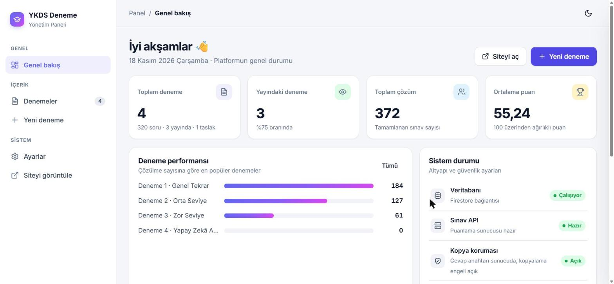<p align="center"><sub>Genel bakış · açık tema</sub></p></td>
    <td width="50%">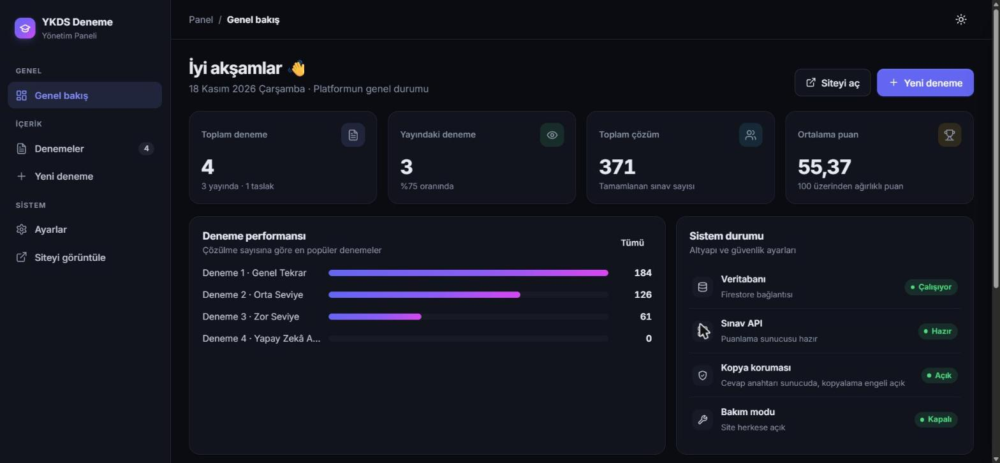<p align="center"><sub>Genel bakış · koyu tema</sub></p></td>
  </tr>
  <tr>
    <td>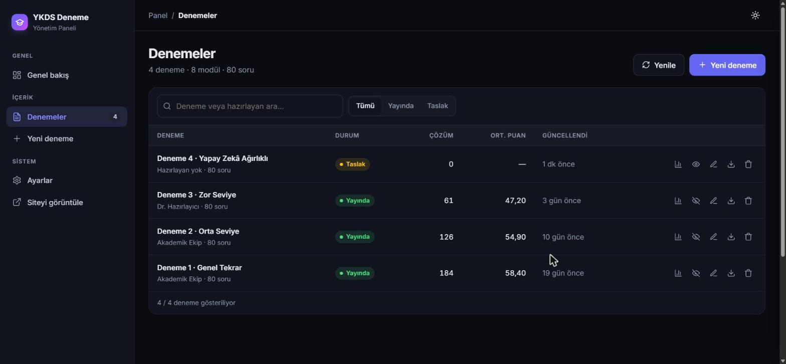<p align="center"><sub>Deneme yönetimi</sub></p></td>
    <td>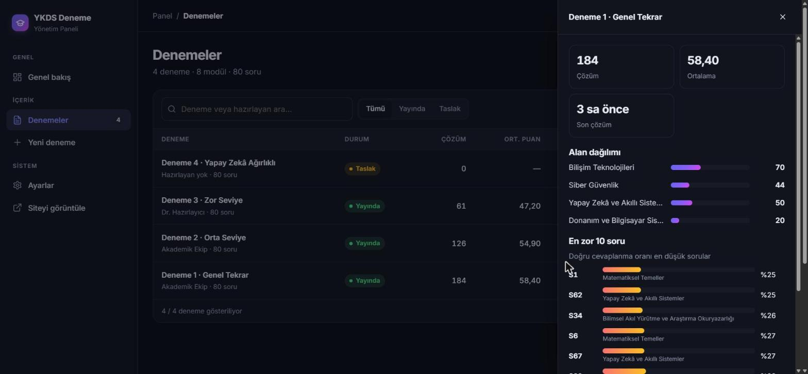<p align="center"><sub>Alan dağılımı ve en zor sorular</sub></p></td>
  </tr>
  <tr>
    <td>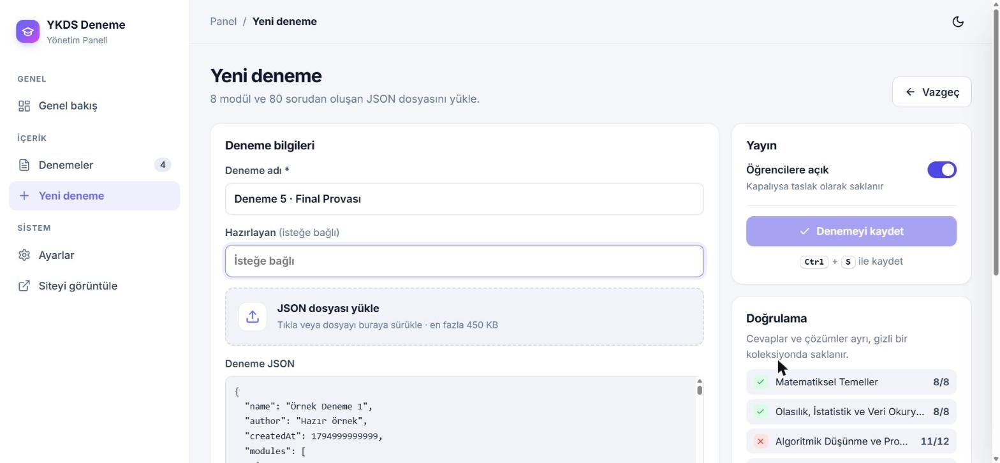<p align="center"><sub>Düzenleyici ve canlı doğrulama</sub></p></td>
    <td>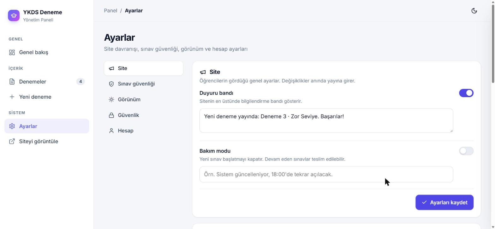<p align="center"><sub>Site ayarları</sub></p></td>
  </tr>
  <tr>
    <td>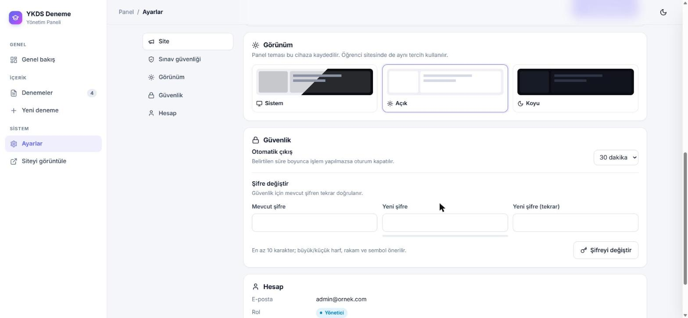<p align="center"><sub>Tema seçimi ve güvenlik</sub></p></td>
    <td>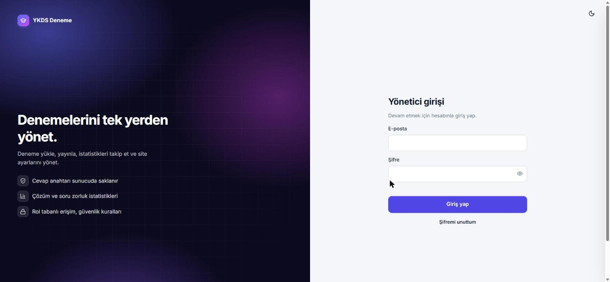<p align="center"><sub>Yönetici girişi</sub></p></td>
  </tr>
  <tr>
    <td>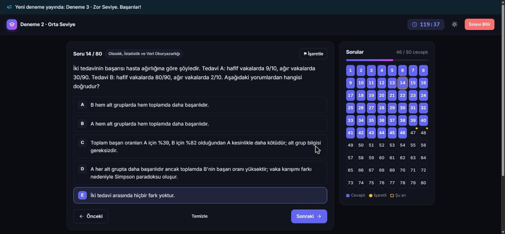<p align="center"><sub>Sınav ekranı</sub></p></td>
    <td><p align="center"><sub>Sonuç ve alt test dağılımı</sub></p></td>
  </tr>
  <tr>
    <td>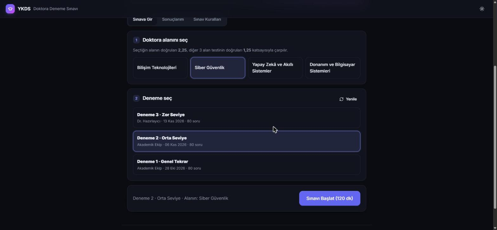<p align="center"><sub>Alan ve deneme seçimi · koyu tema</sub></p></td>
    <td><p align="center"><sub>Çözümlü soru incelemesi</sub></p></td>
  </tr>
</table>

> Görüntüler `npm run dev:mock` ile örnek veriyle alınmıştır.

## Mimari

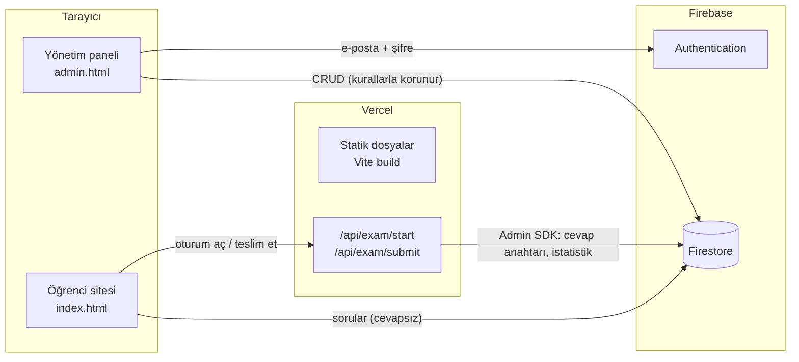

| Koleksiyon | İçerik | Okuma | Yazma |
|---|---|---|---|
| `tests/{id}` | ad, hazırlayan, yayın durumu | yayındaysa herkes | admin |
| `testContents/{id}` | soru metni ve şıklar (**cevap yok**) | yayındaysa herkes | admin |
| `testKeys/{id}` | cevap anahtarı ve çözümler | **yalnızca admin** | admin |
| `testStats/{id}` | çözüm sayısı, ortalama, soru bazlı doğru sayısı | admin | yalnızca sunucu |
| `examTokens/{id}` | tek kullanımlık sınav oturumları | — | yalnızca sunucu |
| `settings/site` | duyuru, bakım, sınav güvenliği | herkes | admin |
| `admins/{uid}` | yönetici listesi | kullanıcının kendisi | yalnızca konsol |

## Güvenlik ve kopya önleme

| Katman | Önlem |
|---|---|
| **Cevap anahtarı** | Sorular ve cevaplar ayrı koleksiyonlarda tutulur. Öğrenci yalnızca cevapsız içeriği okuyabilir. Anahtarı sadece sunucu (Admin SDK) okur ve yalnızca teslimden sonra gönderir. |
| **Sınav oturumu** | `/api/exam/start` HMAC-SHA256 ile imzalı bir belirteç verir. Teslimde imza, deneme ve süre doğrulanır. Belirteç tek kullanımlıktır, tekrar gönderimler istatistiği şişiremez. |
| **API** | Yalnızca POST kabul edilir, farklı siteden gelen istekler reddedilir. Hız sınırı, 16 KB gövde sınırı, `no-store` önbellek ve sıkı girdi doğrulaması uygulanır. |
| **Veritabanı** | Varsayılan olarak her şey kapalıdır. Rol tabanlı erişim (`admins` koleksiyonu) ve şema doğrulaması `firestore.rules` dosyasındadır. |
| **Arayüz** | Sınav sırasında metin seçme, kopyalama, sağ tık, sürükleme ve yazdırma engellenir (ayarlardan kapatılabilir). |
| **Admin oturumu** | Hareketsizlikte otomatik çıkış, art arda hatalı girişte bekleme süresi, şifre değişikliğinde yeniden doğrulama. Şifre sıfırlama, hesabın var olup olmadığını belli etmez. |
| **HTTP başlıkları** | Sıkı CSP, HSTS, `X-Frame-Options: DENY`, COOP, Permissions-Policy. `/admin` için `noindex` ve `no-store`. |
| **Gizli anahtarlar** | Sunucu anahtarları (`FIREBASE_SERVICE_ACCOUNT`, `EXAM_TOKEN_SECRET`) yalnızca Vercel ortamında durur ve istemci paketine girmez. |

## Kurulum

### Gereksinimler
- Node.js 20 veya üzeri
- Bir Firebase projesi (ücretsiz Spark planı yeterli)

### 1. Projeyi çalıştır

```bash
git clone https://github.com/Efe-Eroglu/ykds-simulation.git
cd ykds-simulation
npm install
npm run dev:mock      # Firebase olmadan, örnek veriyle arayüz → http://localhost:5173
```

### 2. Firebase'i yapılandır

1. **Firestore Database → Create database** → bölge `europe-west3` (Frankfurt), *production mode*
2. **Authentication → Get started → Email/Password** sağlayıcısını etkinleştir
3. **Proje ayarları → Genel → Web uygulaması ekle** → `firebaseConfig` değerlerini `.env` dosyasına yaz
4. **Proje ayarları → Hizmet hesapları → Yeni özel anahtar oluştur** → JSON'u tek satır olarak `FIREBASE_SERVICE_ACCOUNT` değişkenine yaz
5. Güvenlik kurallarını yükle:
   ```bash
   npx firebase-tools deploy --only firestore:rules --project <proje-id>
   ```
6. İlk admin hesabını oluştur (şifreyi sen yazarsın, hiçbir yere kaydedilmez):
   ```bash
   npm run create-admin -- admin@ornek.com
   ```

```bash
cp .env.example .env    # değerleri doldur
npm run dev             # gerçek Firebase + yerel /api → http://localhost:5173
```

### 3. Denemeleri yükle

```bash
npm run seed
```
veya `/admin.html` → **Yeni deneme** → JSON dosyasını sürükle → **Kaydet**.

## Canlıya alma (Vercel)

1. <https://vercel.com/new> → bu GitHub deposunu içe aktar (Framework: **Vite**, otomatik algılanır)
2. **Settings → Environment Variables** bölümüne `.env.example` dosyasındaki **8 değişkeni** ekle
3. **Deploy**
4. Firebase Console → **Authentication → Settings → Authorized domains** listesine Vercel alan adını ekle
5. *(Önerilir)* **Authentication → Settings → User actions → Enable create (sign-up)** seçeneğini kapat
6. *(Önerilir)* Firestore → **TTL policies** → `examTokens` koleksiyonunda `expireAt` alanı için TTL tanımla (eski oturum kayıtları kendiliğinden silinir)

> Firebase web yapılandırması (`VITE_FIREBASE_*`) gizli değildir, tarayıcıya gömülür. Güvenliği `firestore.rules` sağlar. `FIREBASE_SERVICE_ACCOUNT` ve `EXAM_TOKEN_SECRET` ise **gizlidir**. Bunlara asla `VITE_` öneki verme ve repoya ekleme.

## Deneme JSON biçimi

```json
{
  "name": "Deneme 3",
  "author": "Hazırlayan",
  "modules": [
    {
      "id": "matematik",
      "questions": [
        {
          "question": "Soru metni (kod için ``` bloğu kullanılabilir)",
          "options": ["A şıkkı", "B şıkkı", "C şıkkı", "D şıkkı", "E şıkkı"],
          "answer": "B",
          "explanation": "Çözüm açıklaması"
        }
      ]
    }
  ]
}
```

| Modül `id` | Alt test | Soru |
|---|---|---:|
| `matematik` | Matematiksel Temeller | 8 |
| `olasilik` | Olasılık, İstatistik ve Veri Okuryazarlığı | 8 |
| `algoritma` | Algoritmik Düşünme ve Problem Çözme | 12 |
| `bilimsel` | Bilimsel Akıl Yürütme ve Araştırma Okuryazarlığı | 12 |
| `bilisim` | Bilişim Teknolojileri | 10 |
| `siber` | Siber Güvenlik | 10 |
| `yapayzeka` | Yapay Zekâ ve Akıllı Sistemler | 10 |
| `donanim` | Donanım ve Bilgisayar Sistemleri | 10 |

**Puanlama:** Ortak Temel doğruları + kendi alan × 2,25 + diğer 3 alan × 1,25 (en yüksek 100).
Admin panelinde örnek JSON indirme ve yapay zekâ ile deneme üretme promptu bulunur.

## Proje yapısı

```
├── index.html, admin.html     Sayfalar
├── api/                       Vercel sunucusuz fonksiyonları
│   ├── exam/start.js          Sınav oturumu açar (imzalı belirteç)
│   ├── exam/submit.js         Puanlar, cevap anahtarını döndürür, istatistik yazar
│   ├── health.js              Yapılandırma durumu
│   └── _lib/                  HTTP, belirteç, Admin SDK yardımcıları
├── src/
│   ├── core/                  Sınav kuralları, doğrulama, puanlama (ortak; sunucu da kullanır)
│   ├── app/                   Öğrenci sitesi
│   ├── admin/                 Yönetim paneli (sayfalar, durum, oturum)
│   ├── services/              Firestore, Auth ve sınav API istemcileri
│   ├── ui/                    DOM, ikon ve tema yardımcıları
│   └── styles/                Tasarım tokenları, site ve panel stilleri
├── dev/mock/                  Firebase'siz geliştirme için sahte servisler
├── assets/brand/logo.svg      Marka logosu (kaynak)
├── scripts/create-admin.mjs   İlk admin hesabını oluşturur
├── scripts/build-icons.mjs    Logodan favicon, PWA ikonları ve OG görseli üretir
├── scripts/seed.mjs           Örnek denemeleri Firestore'a yükler
├── tests/                     Birim testleri (node --test)
├── seed/                      Örnek denemeler
├── firestore.rules            Güvenlik kuralları
└── vercel.json                Yayın ayarları ve güvenlik başlıkları
```

## Komutlar

| Komut | Açıklama |
|---|---|
| `npm run dev` | Geliştirme sunucusu (gerçek Firebase + yerel `/api`) |
| `npm run dev:mock` | Örnek veriyle, Firebase olmadan geliştirme |
| `npm run build` | Üretim paketi (`dist/`) |
| `npm run preview` | Üretim paketini yerelde önizleme |
| `npm test` | Birim testleri |
| `npm run icons` | `assets/brand/logo.svg` kaynağından tüm ikonları yeniden üretir |
| `npm run create-admin -- <e-posta> [--generate]` | Admin hesabı oluşturur (`--generate`: güçlü rastgele şifre) |
| `npm run seed` | `seed/` klasöründeki denemeleri Firestore'a yükler |

## Bilinen sınırlar

- Öğrenci hesabı olmadığı için sonuçlar yalnızca o tarayıcıda saklanır ve cihazlar arasında taşınmaz.
- Anonim bir sistemde kopya tam olarak engellenemez. Örneğin biri ikinci bir sekmede boş sınav teslim ederek anahtarı görebilir. Sistem, geliştirici araçlarıyla cevap görmeyi, kopyalamayı ve istatistik şişirmeyi engeller. Sıralama tablosu gibi rekabetçi bir özellik eklenirse öğrenci girişi de eklenmelidir.
- API hız sınırı sunucusuz örnek başına uygulanır (en iyi çaba). Daha sıkı bir koruma için Firebase App Check veya Vercel Firewall önerilir.

---

<div align="center"><sub>Bu proje bağımsız bir çalışma aracıdır; ÖSYM veya YÖK ile bağlantılı değildir.</sub></div>
